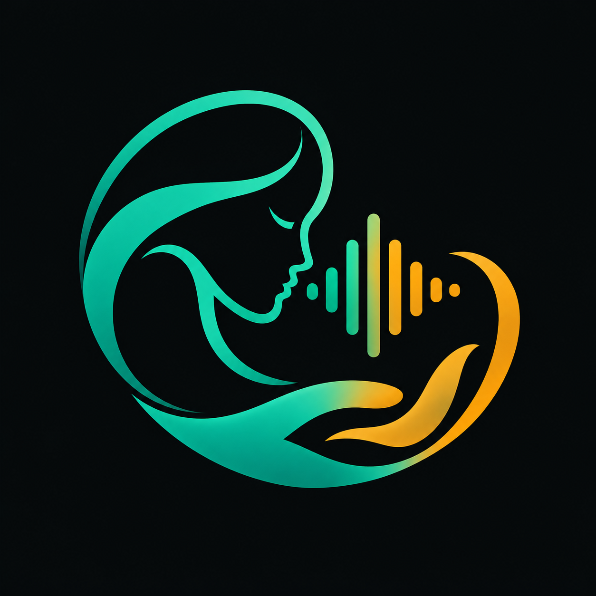

<p align="center">
  
</p>

<h1 align="center">Swasthya-Dhwani · സ്വാസ്ഥ്യ ധ്വനി</h1>

<p align="center">
  <strong>Next-Generation Autonomous Malayalam Voice Emergency Triage & Hospital Routing OS</strong><br>
  <em>Where regional voice AI meets clinical determinism, HL7 FHIR R4 interoperability, and human-in-the-loop governance.</em>
</p>

<p align="center">
  
  
  
  
  
  
  
  
  
  
</p>

---

## 🏥 Overview

In emergency clinical care across Kerala, patients and caregivers calling for urgent triage speak in colloquial Malayalam—often complicated by dysarthria, breathlessness, slurred speech, or panic. Generic conversational LLMs cannot be trusted to assign medical urgency: they hallucinate, fail on acute regional accents, and lack deterministic accountability.

**Swasthya-Dhwani (സ്വാസ്ഥ്യ ധ്വനി)** solves this by decoupling speech understanding from clinical decision-making:
1. **Regional Voice Pipeline:** Leverages **Sarvam AI (Saarika v2.5 STT & Bulbul v3 TTS)** and **Google Gemini 3.1 Flash-Lite** with a multimodal audio-tee architecture to understand distressed Malayalam speech.
2. **Clinical Rule Engine:** Patient acuity is computed **strictly deterministically** via a Kerala Medical Protocol graph (Acuity Tiers **C1, C2, B, A**)—the generative model is never allowed to invent or assign medical priority.
3. **Emergency Stroke Floor:** Detects new or unknown-onset speech impairment signals (`slurred_speech`, `breathlessness`, `voice_tremor`) and automatically enforces a **Tier C1 Acuity Floor** (immediate tertiary referral to a Comprehensive Stroke Centre).
4. **Human-in-the-Loop Governance:** Doctor & nurse operations dashboard with real-time Server-Sent Events (SSE), mandatory reason logging for rejections, and direct HL7 FHIR R4 integration.

---

## ⚡ Key System Innovations

```
                                      ┌─────────────────────────────────────────────────────────┐
                                      │              PATIENT (MOBILE BROWSER / TELEPHONY)       │
                                      │   Malayalam Speech  ▲   ▼  Native Spoken Audio (Bulbul) │
                                      └─────────────────────┬───────────────────────────────────┘
                                                            │ WebRTC Stream
                                                            ▼
┌────────────────────────────────────────────────────────────────────────────────────────────────────────┐
│                                 SWASTHYA-DHWANI VOICE RUNTIME (LIVEKIT)                                │
│                                                                                                        │
│   ┌───────────────────────────┐      Dual Audio Tee       ┌────────────────────────────────────────┐   │
│   │   Sarvam Saarika v2.5     │ ◄───────────────────────► │         TurnAudioBuffer (PCM)          │   │
│   │   Streaming Malayalam STT │                           │         Raw Audio Frame Capture        │   │
│   └─────────────┬─────────────┘                           └───────────────────┬────────────────────┘   │
│                 │ Transcript Hint                                             │ Raw Audio Clip         │
│                 └───────────────────────────────┬─────────────────────────────┘                        │
│                                                 ▼                                                      │
│                               ┌──────────────────────────────────┐                                     │
│                               │   Google Gemini 3.1 Flash-Lite   │                                     │
│                               │   Multimodal Clinical Extraction │                                     │
│                               └─────────────────┬────────────────┘                                     │
│                                                 │ Facts + Impairment Signals                           │
│                                                 ▼                                                      │
│                               ┌──────────────────────────────────┐                                     │
│                               │    Kerala Protocol Rule Engine   │                                     │
│                               │  Deterministic Acuity Assignment │                                     │
│                               └─────────────────┬────────────────┘                                     │
│                                                 │ Tier C1 / C2 / B / A                                 │
└─────────────────────────────────────────────────┼──────────────────────────────────────────────────────┘
                                                  │
                 ┌────────────────────────────────┴───────────────────────────────┐
                 ▼                                                                ▼
┌──────────────────────────────────────────────────┐     ┌─────────────────────────────────────────────────┐
│              HAPI FHIR R4 SERVER                 │     │         CLINICIAN OPERATIONS DASHBOARD          │
│   • Observation (Clinical Symptoms)              │     │   • Real-Time Case Stream (SSE)                 │
│   • Provenance (Model ID & Confidence)           │     │   • Side-by-Side Transcript vs. Model Fact      │
│   • ServiceRequest (Facility Referral)           │     │   • 1-Click Doctor Approval / Rejection         │
│   • AuditEvent (Tamper-evident trail)            │     │   • Telemetry & Emergency Kill-Switches         │
└──────────────────────────────────────────────────┘     └─────────────────────────────────────────────────┘
```

### 1. Deterministic Acuity, Never Generative
The AI agent transcribes speech and extracts clinical slots (`IDENTIFIER`, `SYMPTOMS`, `DURATION`, `WARNING_SIGNS`). The acuity tier is calculated exclusively by `kerala_protocol_mcp.py` against `disease_triage_matrix.json`. When symptoms do not match standard conditions, the case is marked `NO_MATCH` and routed to human handoff—it is **never** silently downgraded to routine care.

### 2. Suspected Stroke Acuity Floor (T2 Fix)
Acute stroke intervention relies on the golden hour. If the multimodal interpreter flags acute speech difficulty with unknown or new onset, the system immediately applies an acuity floor to **Tier C1 (Tertiary / Stroke Centre)**. Conversely, if a caregiver confirms chronic baseline impairment (e.g. ALS, Parkinson's), the stroke floor is responsibly exempted.

### 3. Half-Duplex Acoustic Loop Suppression
To prevent the agent from hearing its own speech through device speakers:
* **Hardware Mic Gating (Client):** The browser mutes the microphone track (`setMicrophoneEnabled(false)`) the millisecond Swasthya's audio begins playback, and unmutes when speech ends.
* **Audio Frame Dropping (Server):** `stt_node` discards all incoming audio frames while the agent is speaking or in post-speech grace delay.
* **Echo Rejection:** Transcripts matching the last spoken agent prompt are dropped before reaching the interpreter.

### 4. Standards-Compliant FHIR R4 Interoperability
Every triage session automatically serializes into:
* `Observation`: Recorded symptoms and vital flags.
* `Provenance`: Interpreter model identity and confidence scores.
* `ServiceRequest`: Specific facility referral and required care tier.
* `AuditEvent`: Full audit trail of clinician decisions and automated timeouts.

---

## 🖥️ Portals & User Roles

| Portal | Route | Access | Capabilities |
| :--- | :--- | :--- | :--- |
| **Patient Voice Intake** | `/patient` | **Public** | Mobile-first screen, interactive microphone, live waveform, real-time Malayalam transcript, 108 emergency ambulance call button. |
| **Operations Queue** | `/dashboard` | **Doctor / Nurse** | Real-time triage feed (SSE), urgency filters (C1 Red, C2 Orange, B Yellow, A Green), pending approvals. |
| **Case Detail Review** | `/dashboard/[taskId]` | **Doctor** | Side-by-side comparison of raw Malayalam STT transcript vs. machine-interpreted facts, FHIR JSON viewer, 1-click referral approval. |
| **Admin & Telemetry** | `/dashboard/admin` | **Administrator** | STT/TTS latency telemetry, on-call roster management, Twilio/SMS emergency kill switches. |
| **Routing Board** | `/dashboard/routing` | **Administrator** | District-by-district facility routing rules and hospital capacity status across Kerala. |

### Seeded Clinician Credentials

Authentication is managed via Keycloak 26 OIDC (`swasthya` realm):

| Role | Username | Password | Permissions |
| :--- | :--- | :--- | :--- |
| **Doctor** | `priya` | `doctor123` | Full clinical triage, approve/reject hospital referrals, clinical audio inspection |
| **Triage Nurse** | `anand` | `nurse123` | Patient intake, vitals review, case tracking |
| **Administrator** | `admin` | `admin123` | System telemetry, routing matrix configuration, emergency kill switches |

---

## 🚀 Quickstart & Local Setup

### Prerequisites
* **Python 3.11+**
* **Node.js 20+** and **npm 10+**
* **Docker & Docker Compose**

### 1. Clone & Configure Environment
```bash
git clone https://github.com/shawnsony07/swasthya-dhwani.git
cd swasthya-dhwani
cp .env.example .env
```
Fill in your API credentials in `.env`:
* `SARVAM_API_KEY`: For Malayalam STT (`saarika:v2.5`) and TTS (`bulbul:v3`).
* `GEMINI_API_KEY`: For multimodal speech interpretation (`gemini-3.1-flash-lite`).
* `LIVEKIT_URL`, `LIVEKIT_API_KEY`, `LIVEKIT_API_SECRET`: From your LiveKit Cloud project.

### 2. Launch with One Command (Docker Compose)
Start the complete 6-container production stack:
```bash
docker compose up -d --build
```

Services initialized:
* **PostgreSQL 16**: Port `5432`
* **HAPI FHIR R4**: Port `8080`
* **Keycloak 26 OIDC**: Port `8081`
* **FastAPI Backend**: Port `8000`
* **Next.js Dashboard & Patient Portal**: Port `3001` (or `3000`)

---

## 🧪 Running the Test Suite

Swasthya-Dhwani maintains 100% pass rates across **126 automated unit and integration tests**:

```bash
# Install development dependencies
pip install -e ".[dev]"

# Run full pytest suite
pytest tests/ -v

# Static analysis & type checking
ruff check src tests
mypy src --ignore-missing-imports

# Protocol graph consistency check
python -m swasthya.protocol.ingest_protocol --check

# End-to-end replay simulation (10 clinical scenarios)
python simulate_e2e.py
```

---

## 🌐 Instant Free Deployment (Cloudflare Tunnel)

To test the mobile voice portal on an actual smartphone with microphone access without renting a VPS or owning a custom domain:

```powershell
# 1. Start the tunnel to the Next.js frontend
cloudflared tunnel --url http://localhost:3001
```

1. Cloudflare instantly generates a public HTTPS URL (e.g., `https://your-tunnel-name.trycloudflare.com`).
2. Open `https://your-tunnel-name.trycloudflare.com/patient` on any iOS or Android phone.
3. Microphone permissions are granted automatically over HTTPS.

---

## 📂 Project Structure

```
swasthya-dhwani/
├── dashboard/                  # Next.js 15 App Router frontend
│   ├── src/app/dashboard/      # Clinician Operations Queue, Admin & Routing
│   ├── src/app/patient/        # Mobile Patient WebRTC Talking Dashboard
│   ├── src/auth.ts             # Auth.js / NextAuth v5 Keycloak OIDC integration
│   └── src/proxy.ts            # Route protection & session middleware
├── docker/                     # Docker configuration & multi-stage Dockerfiles
│   ├── keycloak/               # Seeded swasthya realm JSON
│   ├── api.Dockerfile          # Multi-stage Python FastAPI container
│   └── dashboard.Dockerfile    # Standalone Next.js production container
├── deploy/                     # VPS automated provisioning & Caddy configuration
│   ├── setup_vps.sh            # 1-click Ubuntu setup script
│   └── Caddyfile               # Automatic Let's Encrypt reverse proxy
├── docs/                       # Architecture diagrams, specifications & guides
│   ├── architecture.md         # Full system architectural specification
│   ├── api_contract.md         # REST API & SSE contract
│   └── TELEPHONY_SIP_SETUP.md  # LiveKit SIP & Twilio telephony guide
├── src/swasthya/               # Core Python package
│   ├── api/                    # FastAPI endpoints, auth & SSE alerts
│   ├── db/                     # SQLAlchemy models & Alembic migrations
│   ├── fhir/                   # HAPI FHIR R4 clinical record adapter
│   ├── gateway/                # Action gateway, rate limiter & kill switches
│   ├── interpreter/            # Gemini multimodal interpreter & injection defenses
│   ├── protocol/               # Deterministic Kerala matrix & stroke acuity floor
│   ├── voice/                  # LiveKit WebRTC agent, audio tee & dialogue loop
│   └── workflow/               # State machine & timeout auto-escalations
└── tests/                      # 126 automated unit and integration tests
```

---

## 📜 License & Compliance

* **License:** Apache License 2.0.
* **Clinical Disclaimer:** *Swasthya-Dhwani is an emergency clinical triage support and hospital routing tool. All AI interpretations are clearly flagged with honesty cues and require physician approval prior to final hospital admission.*
